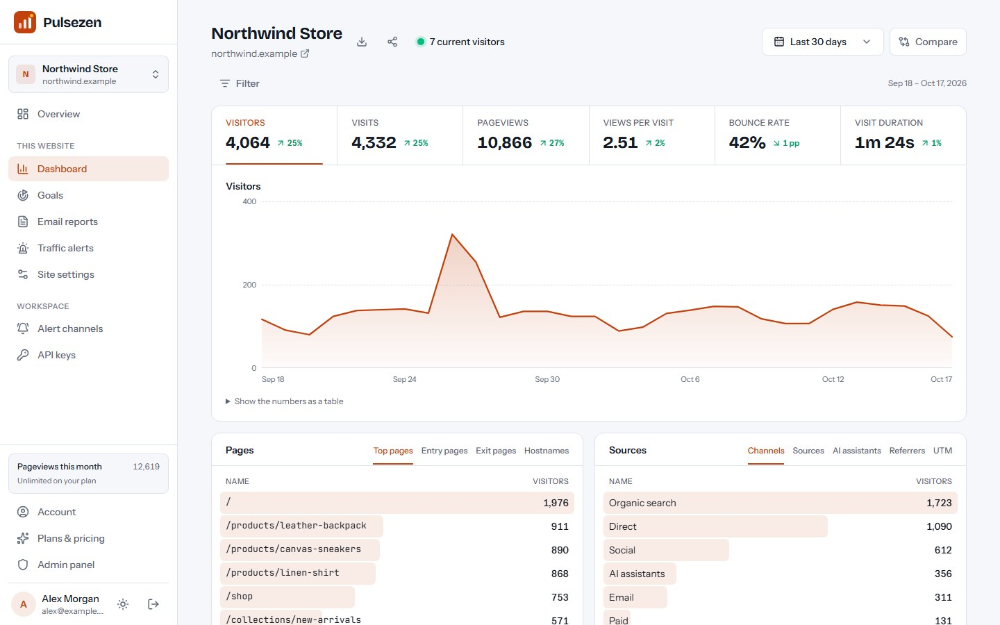
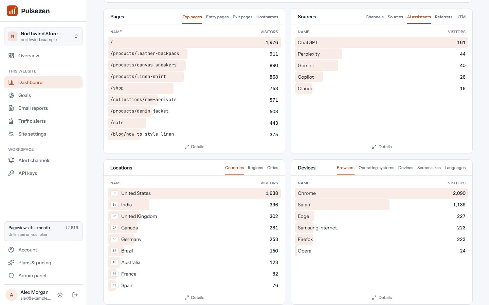
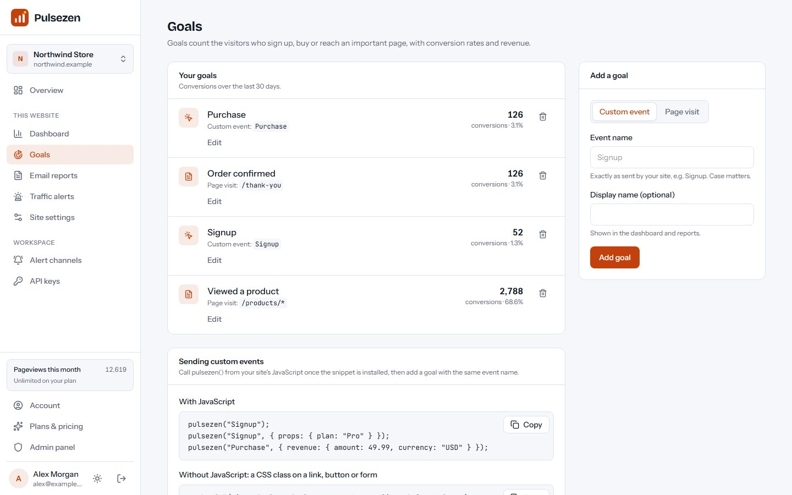
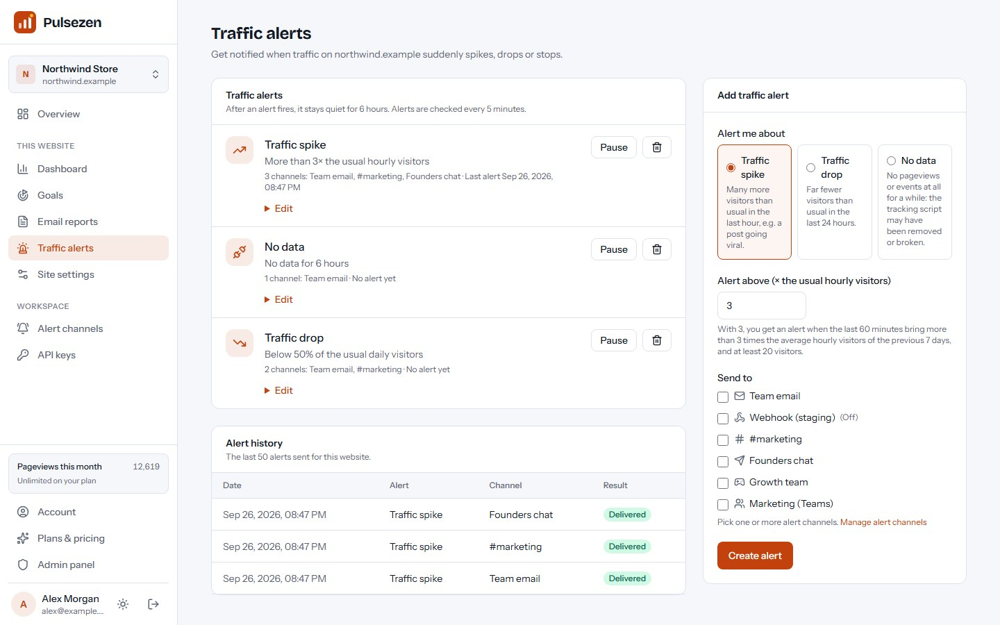
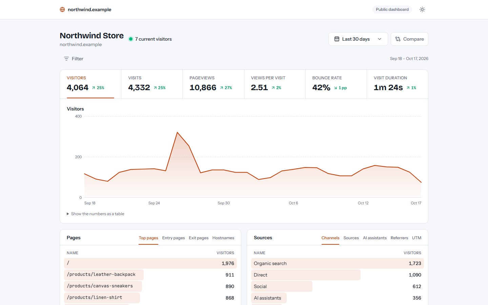
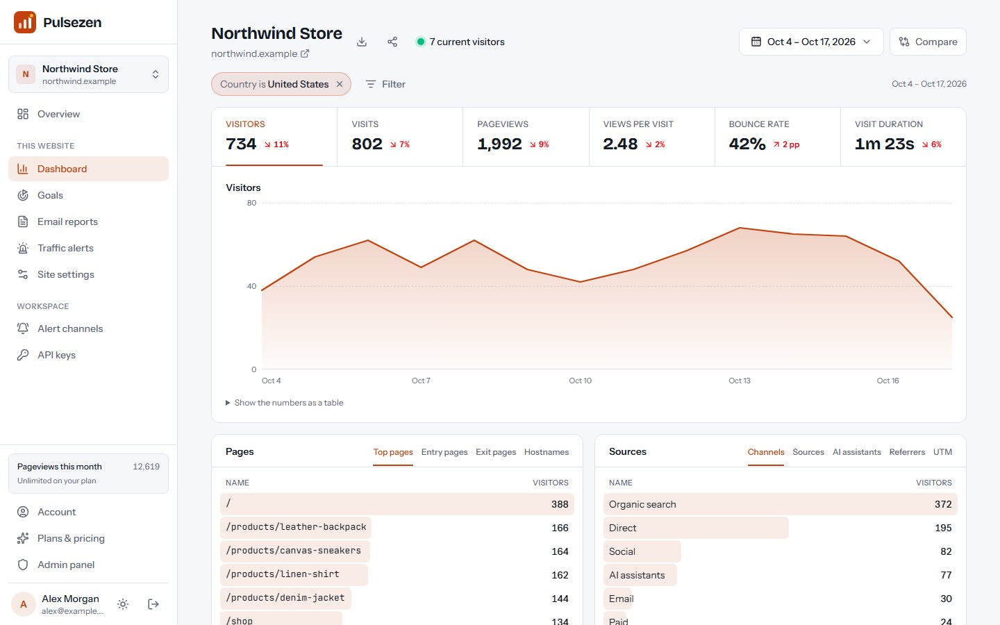
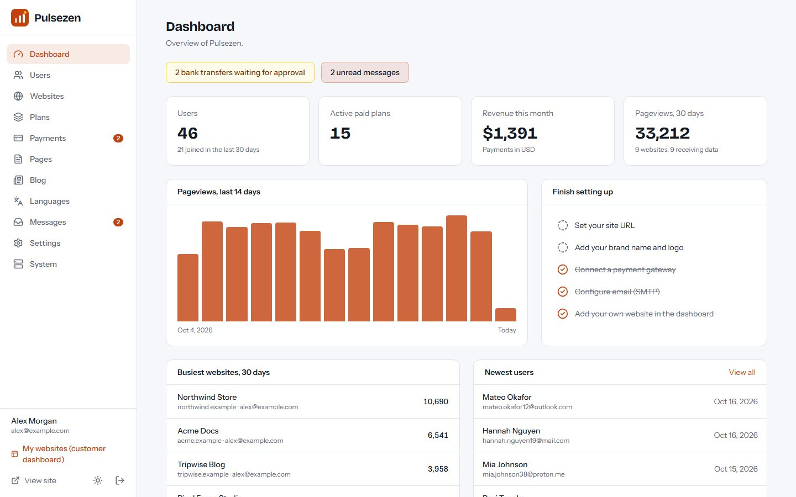

# Pulsezen

**Open-source, privacy-friendly website analytics — a cookieless Google Analytics alternative you
run as a self-hosted SaaS.** Built with Next.js 16, React 19 and Tailwind CSS 4. Runs on a VPS,
Docker, cPanel (Node.js) or Vercel, with MySQL/MariaDB or a zero-setup SQLite database.

**Live demo:** https://pulsezen-iota.vercel.app — log in with `demo@pulsezen.app` / `demo12345`.



## Features

- **Cookieless tracking:** no cookies, no local storage, no fingerprinting; anonymous visitor ids
  from a salt that changes every day, and IP addresses are never stored.
- **Tiny script:** `pz.js` is about 1.5 KB gzipped, has no dependencies and tracks single-page apps
  (history and hash routing) automatically.
- **All key metrics:** visitors, visits, pageviews, views per visit, bounce rate, visit duration,
  realtime visitors and comparison with the previous period.
- **Sources & AI traffic:** channels (direct, search, social, AI assistants, email, paid, referral),
  50+ named sources, referrers and UTM campaigns.
- **Locations & devices:** countries, regions and cities (Vercel/Cloudflare headers or a free GeoIP
  file), browsers, operating systems, devices, screen sizes and languages.
- **Goals & revenue:** page and event goals, custom events with properties and revenue, outbound
  links, file downloads and 404s; filter the whole dashboard by any row.
- **Reports & alerts:** weekly or monthly email reports, and traffic alerts (spikes, drops, broken or
  missing script) by email, signed webhook, Slack, Discord, Microsoft Teams or Telegram.
- **Shared dashboards:** secret public links with an optional password, iframe embed and CSV export.
- **Stats API:** aggregate, timeseries and breakdown endpoints with filters.
- **SaaS ready:** customer accounts, plans with website / pageview / retention / API limits and
  branding removal, Stripe / PayPal / Razorpay / bank transfer payments, a blog and a full admin panel.
- **Multi-language** with right-to-left support (Arabic and Hindi packs included).
- **Web installer** — no command line needed on shared hosting.

| AI traffic | Goals | Traffic alerts |
| --- | --- | --- |
|  |  |  |
| **Shared dashboard** | **Filters** | **Admin panel** |
|  |  |  |

More screenshots are in [`marketing/final/screenshots`](marketing/final/screenshots).

## Hosted version & paid installation

Need Pulsezen hosted for you, installed on your own server, or customised? Contact
**[EpiFive](https://www.epifive.com/services)**.

More open-source projects: https://www.epifive.com/open-source

## Quick start

```bash
git clone https://github.com/epifive/pulsezen.git
cd pulsezen/app
npm install
npm run dev
```

Open http://localhost:3000 — you are redirected to the web installer at `/install`. Choose
**SQLite** for a zero-setup local database, or **MySQL/MariaDB** for production. `npm run dev` also
builds the tracking script `public/pz.js`.

Production, Docker, PM2, cPanel and Vercel setups, background jobs (lazy mode, cron URL or
`npm run worker`), GeoIP and every setting are covered in [`app/README.md`](app/README.md) and the
full guide in [`documentation/index.html`](documentation/index.html) (open it in a browser).

**Requirements:** Node.js 20.9+ (22.13+ for SQLite), MySQL 5.7+ / MariaDB 10.3+ or SQLite, and
HTTPS in production (customers' websites load `https://your-domain/pz.js`).

## Repository layout

| Path | What |
| --- | --- |
| `app/` | The Next.js application (dashboard, tracker, ingest and Stats API, shared dashboards, admin, installer, worker) |
| `documentation/` | Full user and admin guide (single HTML file) |
| `marketing/` | Screenshot and preview scripts and the final screenshots |

## Contributing

Bug reports and pull requests are welcome — please open an
[issue](https://github.com/epifive/pulsezen/issues) first for larger changes. Run
`npm run lint`, `npm run typecheck` and `npm run build` in `app/` before sending a PR.

## License

[MIT](LICENSE) © 2026 EpiFive
